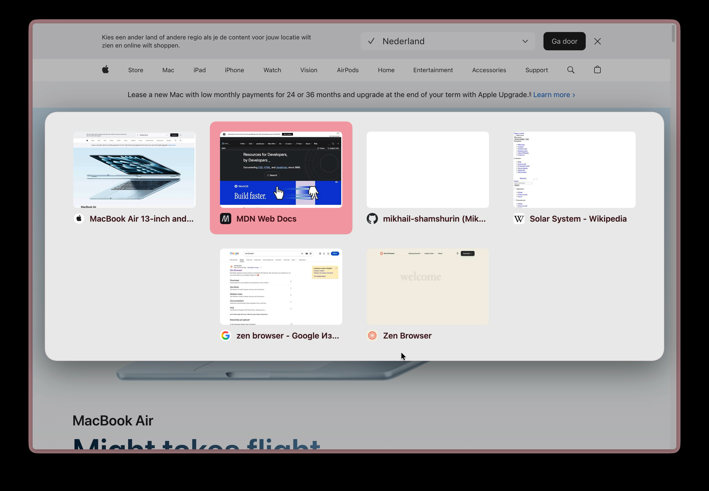

<p align="center">
  <b>English</b> · <a href="README.ru.md">Русский</a>
</p>

<h1 align="center">Better Tab Switcher (Ctrl+Tab)</h1>

<p align="center">
  A tab switcher for <a href="https://zen-browser.app">Zen Browser</a> with page previews and compact cards.
</p>

<p align="center">
  
</p>

## Features

- While you hold Ctrl, cards with previews of your recent tabs appear over the page. Tab moves forward, Shift+Tab moves back, releasing Ctrl opens the selected tab.
- Compact cards follow the Arc layout, with rounded previews and a centered position.
- Colors and background follow your Zen theme. The panel uses the workspace color scheme to keep tab titles readable.
- A quick Ctrl+Tab press jumps straight to the previous tab without flashing the overlay (the show delay is configurable).
- Tabs are ordered by recent use (MRU).
- The panel fits up to five columns. Each row is centered, including the last row. Extra rows scroll vertically.
- Arrow keys move the selection, Enter confirms, Esc cancels. Mouse movement selects a card while Ctrl is held. Keyboard navigation ignores a stationary pointer until the mouse moves again. Clicking switches immediately.
- By default, tabs of the current space and Essentials are shown.
- Closed pinned tabs are excluded from the switcher. Loaded pinned tabs and ordinary unloaded tabs remain available.

## Installation

1. In Sine open Settings and enable "Enable installing JS from unofficial sources" (`sine.allow-unsafe-js`), because the mod contains JS.
2. Install the mod from this repository with the Sine manager.
3. Restart Zen.

## Settings

| Setting | Value |
|---|---|
| Show tabs from all spaces | off by default |
| Overlay show delay, ms | number, default 150, `0` shows it immediately |
| Maximum cards | number from 2, default 9 |

## Development

The script is split into small classes, each with one job:

| Part | Responsibility |
|---|---|
| `BetterTabSwitcher` | wires everything to the window's keyboard and tab events |
| `KeyboardShortcuts` | turns key presses into switcher commands |
| `TabSwitcher`, `CardSelection` | one Ctrl+Tab gesture: begin, move, commit, cancel |
| `collectSwitchableTabs` | which tabs are offered: space, Essentials, card limit |
| `TabHistory` | tabs in the order of use (MRU) |
| `TabPreviews` | page snapshots for the cards |
| `SwitcherOverlay` | the overlay DOM; styles live in `chrome.css` |
| `Settings` | the prefs from `preferences.json` |
| `ZenWindow` | the only code that touches `gBrowser` and `gZenWorkspaces` |

CSS controls card sizes, column wrapping and panel width. JavaScript creates cards and keeps the selected card visible.

The overlay scrolls when the panel exceeds the window height. This keeps the scrollbar outside the panel.

Tests run the script in Node against a fake Zen window and need no dependencies (Node 20 or newer):

```sh
npm test
```
