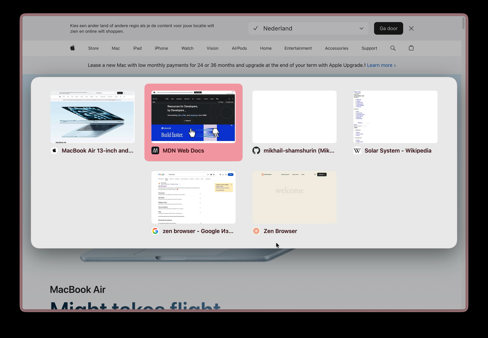

<p align="center">
  <a href="README.md">English</a> · <b>Русский</b>
</p>

<h1 align="center">Better Tab Switcher (Ctrl+Tab)</h1>

<p align="center">
  Переключатель вкладок для <a href="https://zen-browser.app">Zen Browser</a>: превью страниц и компактные карточки.
</p>

<p align="center">
  
</p>

## Возможности

- Поверх страницы появляются карточки с превью последних вкладок, пока держишь Ctrl. Tab листает вперёд, Shift+Tab назад, отпускание Ctrl открывает выбранную вкладку.
- Карточки повторяют размеры и отступы Arc: скруглённые превью и положение по центру окна.
- Цвета и фон берутся из темы Zen. Панель использует цветовую схему рабочего пространства, чтобы названия вкладок оставались читаемыми.
- Быстрое нажатие Ctrl+Tab сразу возвращает на предыдущую вкладку, оверлей не мигает (задержка показа настраивается).
- Порядок вкладок по давности использования (MRU).
- Контейнер подстраивается под карточки и содержит не более пяти столбцов. Все строки располагаются по центру, включая последнюю. Если строки не помещаются по высоте окна, появляется вертикальная прокрутка.
- Стрелки листают, Enter подтверждает, Esc отменяет. Движение мыши выбирает карточку, пока зажат Ctrl. После нажатия клавиш неподвижный указатель не влияет на выбор до движения мыши. Клик сразу переключает вкладку.
- По умолчанию показываются вкладки текущего пространства и Essentials.

## Установка

1. Sine → Settings → включи «Enable installing JS from unofficial sources» (`sine.allow-unsafe-js`), потому что мод содержит JS.
2. Установи мод из репозитория через менеджер Sine.
3. Перезапусти Zen.

## Настройки

| Настройка | Значение |
|---|---|
| Показывать вкладки всех пространств | выкл по умолчанию |
| Задержка показа оверлея, мс | число, по умолчанию 150, `0` — сразу |
| Максимум карточек | число от 2, по умолчанию 9 |

## Разработка

Скрипт разбит на небольшие классы, у каждого одна задача:

| Часть | Отвечает за |
|---|---|
| `BetterTabSwitcher` | связывает всё с клавиатурой и событиями вкладок окна |
| `KeyboardShortcuts` | превращает нажатия клавиш в команды переключателя |
| `TabSwitcher`, `CardSelection` | один жест Ctrl+Tab: начать, листать, подтвердить, отменить |
| `collectSwitchableTabs` | какие вкладки показывать: пространство, Essentials, лимит карточек |
| `TabHistory` | вкладки в порядке использования (MRU) |
| `TabPreviews` | снимки страниц для карточек |
| `SwitcherOverlay` | DOM оверлея; стили в `chrome.css` |
| `Settings` | настройки из `preferences.json` |
| `ZenWindow` | единственный код, который обращается к `gBrowser` и `gZenWorkspaces` |

CSS задаёт размеры карточек, перенос строк и ширину панели. JavaScript создаёт карточки и удерживает выбранную карточку в видимой области.

Если панель превышает высоту окна, прокручивается оверлей. Полоса прокрутки остаётся за пределами панели.

Тесты запускают скрипт в Node на фейковом окне Zen, зависимостей нет (нужен Node 20 или новее):

```sh
npm test
```
